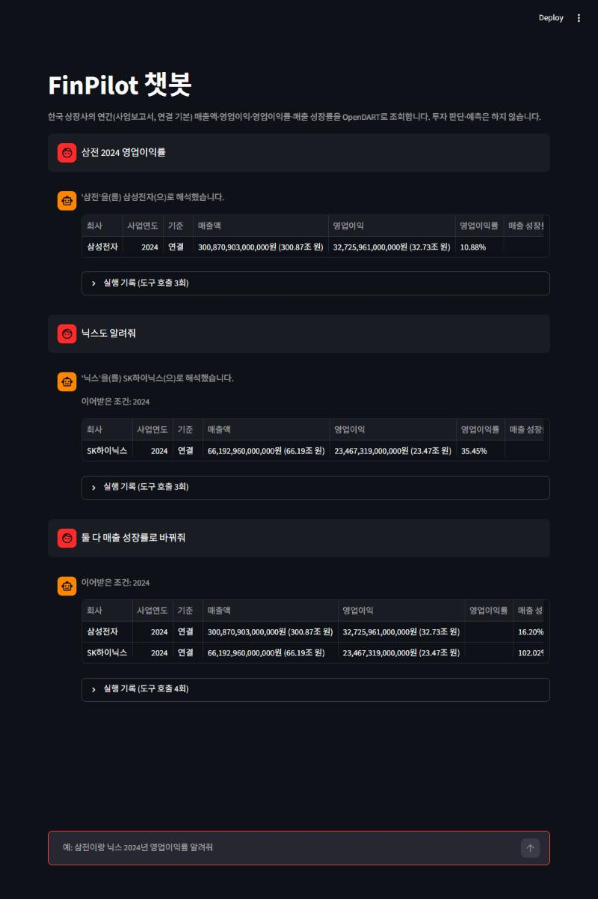
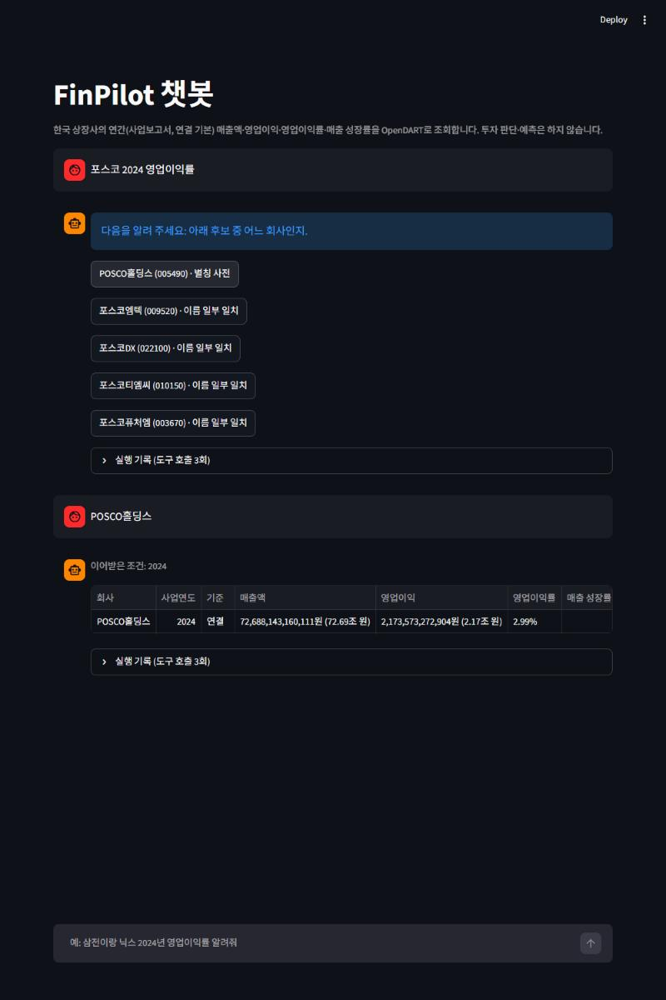
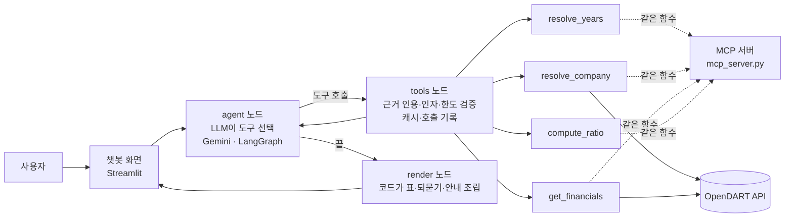

# FinPilot

### OpenDART 공시로 한국 상장사 재무를 조회하고, 출처(접수번호)와 함께 답하는 AI 에이전트

      

| 기간 | 형태 | 진행 방식 | AI 도구 |
|---|---|---|---|
| 2026.10.08 ~ (진행 중) | 포트폴리오 프로젝트 (개인) | 단계별 설계·구현·평가 | Claude Code |

연간 **매출액·영업이익·영업이익률·매출 성장률**을 조회·계산하는 챗봇형 에이전트입니다.

> **숫자는 코드가 만들고, LLM은 도구를 고르고, 모르면 되묻는다.** 틀린 값을 정상처럼 보여 주지 않는 것을 가장 중요한 목표로 삼았습니다.

## 어떤 대화가 되나

```
사용자  삼전 2024 영업이익률
챗봇   (해석) '삼전'을(를) 삼성전자(으)로 해석했습니다.
       삼성전자 2024사업연도 연결 | 매출액 300.87조 원 | 영업이익 32.73조 원 | 영업이익률 10.88% | 접수번호 20250311001085

사용자  닉스도 알려줘
챗봇   (이어받은 조건) 2024
       SK하이닉스 2024사업연도 연결 | 매출액 66.19조 원 | 영업이익 23.47조 원 | 영업이익률 35.45%

사용자  둘 다 매출 성장률로 바꿔줘
챗봇   삼성전자 매출 성장률 16.20% · SK하이닉스 매출 성장률 102.02%

사용자  삼성전자 2024년 1분기 영업이익
챗봇   분기·반기·월 단위는 아직 지원하지 않아요. 연간 사업보고서 기준만 조회할 수 있어요.

사용자  삼성전자 영업이익률            ← 연도를 말하지 않으면 추측하지 않고 되묻는다
챗봇   다음을 알려 주세요: 어느 사업연도인지.
```

위 대화는 평가 때 실제로 나온 답변을 이어 붙인 예시입니다(앞 세 턴은 한 대화, 뒤 두 질문은 각각 별도 대화).

실제 화면(Streamlit, 2026-10-21 직접 실행):

| 이어받기·성장률 변경 | 모호한 회사 → 후보 선택 |
|---|---|
|  |  |

더 많은 실제 질문·답변은 [어려운 질문 26개 Q&A](docs/evaluation/agent_hard_qa.md)에 도구 호출 기록과 함께 있습니다.

## 설계 핵심

| 문제 | 해결 |
|---|---|
| LLM이 사용자가 말하지 않은 연도·회사를 지어 씀 | 도구를 부를 때 **사용자 문장에서 그대로 인용한 근거**를 받고, 코드가 실제 대화와 대조해 거부 (인용이 "아무 부분"이어도 통과하던 우회까지 막음) |
| LLM이 숫자를 잘못 쓰거나 형식을 바꿈 | **숫자·표·되묻기·거절 문구는 코드가 생성**하고, 설명 문장은 숫자가 하나라도 있으면 버림 |
| 회사 이름이 모호함(삼성, 현대), 같은 이름의 폐지 법인(삼성물산), 해외 기업 | 유명 별칭·초성은 목록과 대조해 바로 확정, 모호하면 후보를 보여 주고 사용자가 확정, 해외·비상장은 "조회할 수 없다"고 안내 |
| 분기·별도 기준을 물으면 연간 연결 값을 내보냄 | 지원하지 않는 기간은 조회 없이 거절, 별도 기준은 사용자가 말했을 때만 허용 |
| 정정공시가 흔함 | OpenDART가 주는 최신 정정본을 쓰고 접수번호·접수일·정정 여부를 표시 |
| 에이전트가 헛돎 | 도구 호출 40회·요청 10개 한도, 같은 호출은 캐시, 검증 오류가 쌓이면 중단하고 되묻기 |

## 구조



- 같은 도구 함수(`tools.py`)를 에이전트와 **MCP 서버**가 함께 씁니다. MCP 서버에는 LLM이 없고 입력 검증과 오류 반환만 합니다.
- 대화 상태는 화면 세션 메모리에만 있습니다(DB 없음).

## 평가 (자체 평가셋, 정답은 직접 작성)

| 무엇을 | 결과 |
|---|---|
| 데이터 정확도 | 삼성전자·SK하이닉스·현대자동차 2022~2025 매출·영업이익을 DART 원문과 직접 대조해 일치 |
| 틀린 값을 정상처럼 표시 | 기준선(단일 요청 파이프라인) **18건 → 에이전트 0건**, 모든 평가 묶음에서 0건 |
| 처음 보는 질문 25개(held-out) | 65/75 (86.7%). 평가셋 작성 오류 2건을 정정하면 71/75 |
| 어려운 질문 26개(비교·의견·정정·주입·한계·여러 턴) | 49/52 |
| 한 턴 평균 | 약 3초, 도구 호출 약 3.5회, 토큰 약 4,500 |

**한계(솔직하게):** 평가 질문이 적고 정답을 제가 작성했으며 사람 검토 전입니다. dev 묶음은 고치면서 쓴 묶음이라 일반화 점수가 아닙니다. 은행·보험·일부 기업은 매출 계정 구조가 달라 조회하지 못하고 오류로 알립니다. 분기 조회, "그 전년도는?" 같은 직전 답 기준 상대 연도는 지원하지 않습니다. 한국 공시(OpenDART)만 다룹니다. 자세한 수치와 실패 사례는 [평가 결과](docs/evaluation/eval_results.md)에 있습니다.

## 실행

```bash
python -m venv .venv
.venv\Scripts\activate            # macOS/Linux: source .venv/bin/activate
pip install -r requirements.txt
```

`.env`(저장소에 올리지 않음, `.env.example` 참고)에 키를 둡니다.

```
DART_API_KEY=...     # OpenDART 인증키
GEMINI_API_KEY=...   # 에이전트·질문 해석(MCP 서버만 쓸 때는 불필요)
```

```bash
streamlit run chat_app.py        # 챗봇형 에이전트 (LangGraph)
streamlit run app.py             # 입력 폼형 단일 요청 파이프라인 (비교 기준선)
python mcp_server.py             # MCP 서버 (stdio)
python -m pytest                 # 오프라인 테스트 220개 (키·네트워크 불필요)
python -m pytest tests_live      # 실제 OpenDART·MCP 별도 프로세스 호출 (키 필요)
python -m eval.run_agent_eval 3  # 에이전트 평가 (Gemini·OpenDART 호출)
```

### MCP 서버 연결

MCP 클라이언트 설정에 서버를 등록합니다(경로는 본인 환경에 맞게).

```json
{"mcpServers": {"finpilot": {"command": "C:/경로/FINPILOT/.venv/Scripts/python.exe", "args": ["C:/경로/FINPILOT/mcp_server.py"]}}}
```

제공 도구: `resolve_years`(연도 표현 → 사업연도, 오늘 날짜 기준), `resolve_company`(회사 확정), `get_financials`(연간 매출·영업이익), `compute_ratio`(영업이익률·매출 성장률). 이 서버는 자체 MCP 클라이언트(프로세스 내와 별도 프로세스 stdio)로 검증했고, Claude Code의 `claude mcp list`에서 연결(Connected)까지 확인했습니다. 외부 LLM 앱이 도구를 실제로 호출하는 것까지는 확인하지 못했습니다.
`mcp` 패키지는 2.x가 Claude Code 2.1.222와 프로토콜 협상에 실패해(오류 -32022) `mcp<2`(1.30.0, FastMCP)로 고정했습니다.

## 기술 스택
Python 3.14 · LangGraph · Gemini(`gemini-3.5-flash-lite`, Tool Calling) · OpenDART API · MCP(Python SDK) · Streamlit · LangSmith(추적, 월 한도로 평가에서는 끔) · pytest

## 문서
- [문서·결과 목차](docs/index.md) · [에이전트 설계와 구현 현황](docs/backlog/agent_design.md) · [평가 결과](docs/evaluation/eval_results.md) · [테스트·검증 기록](docs/verification/test_results.md) · [정책 결정](docs/backlog/policies.md) · [회고](docs/회고.md)
- [조회 기준·회사 선택·검증 기록(상세)](docs/reference.md)
- 코드: `agent_core.py`(에이전트) · `tools.py`(도구) · `mcp_server.py` · `chat_app.py` · `dart.py`(OpenDART) · `finance.py`·`app.py`·`question.py`(기준선 파이프라인) · `eval/`(평가셋·실행기) · `tests/`, `tests_live/`
