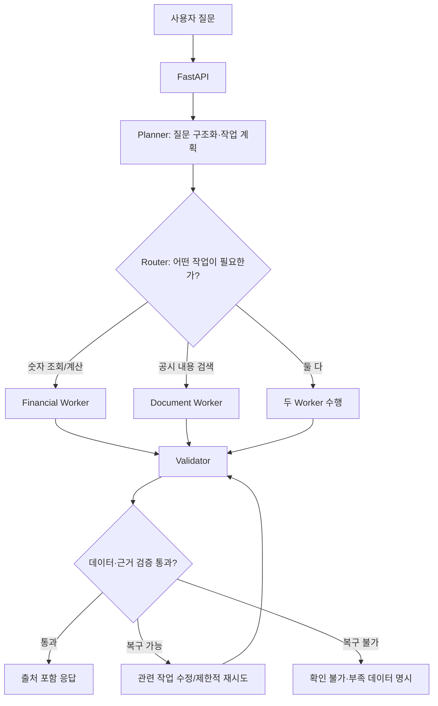

# FinPilot — 금융 데이터 기반 AI Research Agent & MCP 서비스

> 프로젝트 기획서 v0.1 · 2026-10-16  
> 목적: **에프앤가이드 AI팀 채용전환형 인턴 지원을 위한 1인 사이드 프로젝트·포트폴리오**, 동시에 사용자가 실제 기업 분석에 활용할 수 있는 서비스.  
> 우선 관심사: **Agent Workflow 설계, Tool Calling, MCP, 실패 복구 및 성능 개선**.  
> 현재 상태: 기획/금융 기초 학습 단계. API 실습 및 서비스 구현·평가는 **아직 진행 완료되지 않음**.  
> 학습 노트: [금융 기초 학습 노트](finance_study_notes.md)

## 목차

1. [프로젝트 한 문장 소개](#1-프로젝트-한-문장-소개)
2. [문제와 필요성](#2-문제와-필요성)
3. [목표 사용자와 사용 시나리오](#3-목표-사용자와-사용-시나리오)
4. [MVP 범위와 제외할 것](#4-mvp-범위와-제외할-것)
5. [Agent 작동 방식](#5-agent-작동-방식)
6. [금융 MCP Tool 설계](#6-금융-mcp-tool-설계)
7. [금융 데이터·품질 검증 정책](#7-금융-데이터품질-검증-정책)
8. [기술 스택과 저장 구조](#8-기술-스택과-저장-구조)
9. [차별화 지점](#9-차별화-지점)
10. [성능 개선 실험](#10-성능-개선-실험)
11. [개발 계획](#11-개발-계획)
12. [완료 기준과 포트폴리오 산출물](#12-완료-기준과-포트폴리오-산출물)
13. [결정·가설·미해결 사항](#13-결정가설미해결-사항)
14. [확장 계획: 리포트 테마 추출](#14-확장-계획-리포트-테마-추출)

---

## 1. 프로젝트 한 문장 소개

> **사용자의 금융 질문을 작업으로 분해하고, 금융 API·문서 검색·계산 도구를 호출하여 기업 실적을 분석한 뒤, 검증된 근거와 함께 답하는 AI Agent.**

작업명은 **FinPilot**. 초기 아이디어에는 FinScope(기업 분석 Agent), FinanceRetrieve(RAG 검색 엔진)도 있었지만, 지금 선택한 방향은 **FinPilot: Tool-Orchestrated Financial Research Agent**다.

단순 문서 요약 챗봇보다 **올바른 Tool 선택, 구조화된 실행, 오류 복구, 금융 데이터 검증, 실행 성능 측정**에 무게를 둔다.

## 2. 문제와 필요성

### 사용자의 문제

- 기업을 비교하려면 공시·재무제표·사업보고서 등을 직접 찾아야 한다.
- 매출액·영업이익·성장률 같은 수치와, 성장 원인·위험 요인 같은 텍스트가 따로 흩어져 있다.
- 숫자를 잘못 비교하거나 기준이 다른 자료를 섞으면 그럴듯하지만 잘못된 결론이 나온다.

### 왜 AI Agent인가?

질문의 종류마다 필요한 작업이 다르기 때문이다.

- "작년 매출액은?" → 재무 API 조회.
- "지난 2년 영업이익률을 비교해 줘" → 여러 기간 조회 + Python 계산.
- "영업이익이 감소한 원인을 공시에서 찾아줘" → 재무 정보 + 공시 텍스트 검색(RAG).

고정된 단일 절차보다 **질문별 계획·도구 선택·검증 분기**가 유용하다. 다만 기능이 간단할 때는 일반 API/함수로 해결하고, 필요 이상으로 Agent를 복잡하게 만들지 않는다.

### 채용공고와의 연결

사용자가 제공한 에프앤가이드 AI팀 공고의 주요 역량:

| 채용 요구 | FinPilot에서 증명할 경험 |
|---|---|
| Python 기반 AI 서비스 | FastAPI, 데이터 처리·계산 함수, API 통합 |
| LLM Agent Workflow | LangGraph Planner/Router/Worker/Validator |
| API/Tool 연계 | OpenDART API + 금융 Tool Calling |
| LangGraph 등 프레임워크 | 조건부 분기·체크포인트·실패 복구 |
| MCP / Function Calling / Tool Use | 재사용 가능한 금융 MCP Server |
| Vector DB / RAG | 사업보고서 검색 확장 기능 |
| 금융 데이터 기반 AI | 기간/단위/연결 기준 검증, 공시 근거 추적 |
| 성능 개선 역량 | Tool 선택 정확도·작업 성공률·응답 지연·비용 비교 |

> **지원 자격 및 마감 확인 필요:** 대화 중 받은 채용 정보에 학사/석사 조건의 서로 다른 표기가 있었다. 실제 지원 전에는 기업 공식 채용 페이지와 최신 공고를 확인한다. 특정 마감일에 맞춘 일정은 변동될 수 있다.

## 3. 목표 사용자와 사용 시나리오

**첫 사용자:** 금융을 공부하면서 기업 분석을 해보고 싶은 개인 투자자·개발자인 본인. 장기적으로는 기업 분석 입문자까지 확대 가능.

### 시나리오 A — 단순 재무 조회

> "삼성전자의 2025년 매출액과 영업이익을 알려줘."

1. 기업 식별 → 2. 연도·재무제표 기준 확인 → 3. OpenDART API 조회 → 4. 값·단위·출처 표시.

**Agent 설계 포인트:** 문서 RAG를 쓸 필요가 없으면 건너뛴다.

### 시나리오 B — 공시 내용 검색

> "SK하이닉스의 사업보고서에서 주요 위험 요인을 찾아줘."

1. 기업·문서 식별 → 2. 문서 검색 → 3. 관련 문단·공시 식별자 확보 → 4. 근거 포함 요약.

**Agent 설계 포인트:** 검색이 실패하면 출처 없는 이유를 지어내지 않는다.

### 시나리오 C — 복합 분석

> "삼성전자와 SK하이닉스의 최근 3개년 매출 성장률을 비교하고, 각 회사가 밝힌 주요 성장 요인을 알려줘."

1. 기업별 수치 조회 → 2. 기간별 성장률 계산 → 3. 관련 공시 검색 → 4. 기간/연결 기준 검증 → 5. 비교표와 근거 답변.

**Agent 설계 포인트:** 여러 도구의 결과를 통합하고, 필요한 경우 병렬 실행과 재시도를 제어한다.

## 4. MVP 범위와 제외할 것

### 필수 MVP (첫 단계)

- [ ] 한국 상장기업 1~2개(처음엔 삼성전자) 기업 식별.
- [ ] OpenDART 사업연도별 **매출액·영업이익** 조회.
- [ ] 전년 대비 매출 성장률과 영업이익률 계산.
- [ ] 기본적인 자연어 질문 → Tool 선택 → 실행 → 결과 요약.
- [ ] 출처·기준연도·연결/별도·단위 표시.
- [ ] 오류(기업을 못 찾음, 기간 데이터 없음, API 일시 오류) 처리.
- [ ] Tool 호출 로그/Trace 기록 및 최소 평가 데이터셋 확보.

### 2차 MVP 확장

- [ ] 사업보고서 일부 텍스트 검색(RAG).
- [ ] 기업 2개 비교.
- [ ] Planner/Router/Validator로 구성한 LangGraph 구조.
- [ ] 핵심 Tool을 MCP Server로 공개하고 별도 MCP 클라이언트에서 테스트.
- [ ] V0/V1/V2 성능 비교.

### 초기 제외

- 실시간 주가 예측, 매수·매도 자동 실행, 투자 수익 보장.
- 방대한 금융 문서 크롤링 및 자체 파운데이션 모델 학습.
- 투자자 계좌 연결, 자동주문, 로보어드바이저 법적 서비스화.
- 모든 기업·공시 유형을 한 번에 지원하는 범용 금융 플랫폼.

> **중요:** 금융 정보 탐색·학습 보조 서비스이지 자동 투자 판단이나 투자 권유 시스템이 아니다.

## 5. Agent 작동 방식

### 전체 구조



※ 위 그림은 개념도다. 실제 구현에서는 재시도가 **검증 노드만** 반복하는 것이 아니라 해당 Worker의 조회·검색·계산을 재실행하도록 상태를 구성해야 한다.

### 노드별 책임

| 구성 | 역할 | 초기 구현 방식 |
|---|---|---|
| Planner | 질문에서 기업·기간·원하는 지표·작업을 구조화 | LLM + 구조화 출력 스키마 |
| Router | Financial/Document/Combined 경로 선택 | 검증된 계획 기반 규칙·조건 분기 |
| Financial Worker | 기업 식별, API 수치 조회, 계산 | Python Tool/MCP |
| Document Worker | 공시 본문 검색, 관련 문단 추출 | 초기엔 생략 가능, 이후 RAG |
| Validator | 재무 기준·단위·출처·작업 성공 검증 | Python 규칙 우선, 필요시 LLM 보조 |
| Answer | 계산 결과·표·공시 근거를 사용자에게 전달 | LLM 텍스트 생성 + 구조화된 근거 |

**설계 원칙:** 모든 판단을 LLM에 맡기지 않는다. 수치 계산과 단위 검증은 가능한 한 **결정론적인 Python 코드**로 처리한다.

### 예시 Agent 상태(개념)

```python
from typing import Any, TypedDict

class AgentState(TypedDict, total=False):
    user_question: str
    company_codes: list[str]
    years: list[int]
    requested_metrics: list[str]
    plan: list[dict[str, Any]]
    tool_results: list[dict[str, Any]]
    validation_errors: list[str]
    retry_count: int
    final_answer: str
```

향후 실제 스키마는 과제 범위에 따라 더 엄격하게 타입을 나눈다.

## 6. 금융 MCP Tool 설계

### 목표 Tool 5개

| 이름 | 입력 | 결과 | 우선순위 |
|---|---|---|---|
| `resolve_company` | 회사명 | DART 기업 고유번호, 정식명 | 필수 |
| `get_financials` | 기업번호, 연도, 보고서 코드, 연결/별도 | 매출액·영업이익·메타데이터 | 필수 |
| `calculate_metrics` | 정규화된 수치, 계산 종류 | 영업이익률·성장률 | 필수 |
| `list_disclosures` | 기업번호, 기간, 공시 유형 | 공시 목록·접수번호·날짜 | 확장 |
| `search_filings` | 기업번호, 질의, 문서 조건 | 관련 텍스트·공시 출처·위치 | 확장 |

### 정형 금융 수치 응답 예시(형식 설명용; 가상)

```json
{
  "company_name": "가상 A기업",
  "corp_code": "00000000",
  "business_year": 2025,
  "report_code": "11011",
  "statement_type": "CFS",
  "metric": "revenue",
  "value": 120000000000,
  "currency": "KRW",
  "unit": "원",
  "source": {
    "provider": "OpenDART",
    "report_id": "example-only"
  }
}
```

- 예시는 **가상 스키마**이며 실제 OpenDART 응답 원형은 아니다.
- 금액 계산 전에 콤마·음수·결측·단위 등 원본 값을 정규화한다.
- MCP와 연결해도 **Tool 자체의 입력 스키마 검증·타임아웃·오류 반환**을 따로 구현해야 한다.

### MCP를 도입하는 이유

- 금융 데이터 조회와 계산을 **Agent 본체와 분리**해 재사용할 수 있다.
- 별도 MCP 클라이언트에서 같은 금융 Tool을 발견하고 호출할 수 있다.
- Tool 이름·설명·입출력 스키마·에러 처리 계약을 명확하게 제시할 수 있다.

**MCP 사용 자체가 분석 정확도를 자동 향상시키지는 않는다.** MCP에 대해서는 호환성·재사용성과 운영 안정성을 입증하고, Agent 품질은 별도 성능 평가로 측정한다.

공식 참고: <https://modelcontextprotocol.io/> / <https://docs.langchain.com/oss/python/langgraph/overview>

## 7. 금융 데이터·품질 검증 정책

다음 사항을 지키는 것이 이 프로젝트의 핵심 차별점이다.

1. **기업 식별:** 기업명을 DART `corp_code`에 정확히 매핑했는가?
2. **기간 구분:** 사업연도·보고서 종류·전년동기가 맞는가?
3. **연결/별도 구분:** `CFS`와 `OFS`를 무심코 혼합하지 않았는가?
4. **단위:** 원/천원/백만원/억원/조원을 잘못 환산하지 않았는가?
5. **계정 이름:** 매출액·영업이익·당기순이익을 혼동하지 않았는가?
6. **공시 출처:** 출처, 공시 날짜, 접수번호를 확인했는가?
7. **정정·최신성:** 최신 공시·정정 여부를 검토했는가?
8. **데이터 없음:** 없거나 검증되지 않은 숫자를 만들어내지 않았는가?

**오류 처리 정책 예시**

| 상황 | 처리 방식 |
|---|---|
| API 타임아웃·일시 5xx | 횟수 제한·백오프 후 재시도 |
| 인증키 오류·권한 없음 | 재시도 남발 금지, 정확한 오류 안내 |
| 기업명 중복·모호함 | 후보 표시, 사용자에게 구분 요청 |
| 지정 기간의 공시 없음 | 결측 표시 및 확인 가능한 인접 자료 안내 |
| 연결/별도 기준 불일치 | 동일 기준 재조회 또는 비교 불가 이유 표시 |
| RAG 검색에서 근거 부족 | 제한적 재검색 후 미확인 정보라고 명시 |

## 8. 기술 스택과 저장 구조

| 계층 | 후보 기술 | 도입 이유 |
|---|---|---|
| 언어 | Python | 금융 데이터 가공·AI Tool 구현 |
| API 서버 | FastAPI | 클라이언트 요청과 Agent 연결 |
| Agent | LangGraph | 상태·작업 분기·재시도·체크포인트 |
| 금융 데이터 | OpenDART | 기업공시·재무정보 조회 |
| Tool 인터페이스 | MCP Server | 도구 재사용·표준 호출 |
| 데이터베이스 | PostgreSQL | 정형 데이터·작업 로그 보관 |
| 문서 검색 | pgvector, BM25 등(후속) | 비정형 공시 RAG 검색 |
| 평가·테스트 | pytest, LangSmith(선택) | 재현 가능한 Tool/Agent 실험 |
| UI | CLI 또는 Streamlit → 웹 UI(선택) | 빠른 MVP 및 데모 |

### 데이터 구조(최소 설계)

- `companies`: DART corp_code, 회사명.
- `financial_facts`: 기업, 기준 기간, 보고서 종류, CFS/OFS, 계정, 금액, 단위, 출처, 수집 시간.
- `agent_runs`: 질문, 실행 버전, 최종 상태, 비용·시간 등.
- `tool_calls`: 실행 ID, Tool명, 파라미터(비밀값 제거), 응답 상태, 지연시간, 오류 코드.
- `filing_documents`/`filing_chunks`(확장): 문서 식별자, 문단, 검색 인덱스 정보.

## 9. 차별화 지점

### 9.1 Adaptive Tool Routing

- 단순 숫자 조회라면 RAG·불필요한 LLM 호출을 생략.
- 비교 분석은 복수 조회·계산·검증 Tool을 호출.
- 관찰할 지표: Tool 선택 정확도, 불필요 호출 수, 작업 성공률.

### 9.2 Financial Data Guardrails

- 회계 기준, 사업연도, 금액 단위, 계정 의미를 자동 검증.
- 금융 지식에 근거한 **실패 차단 규칙**을 만들고 테스트.

### 9.3 Self-Recovery

- 일시 오류 vs 구조적 오류를 구분.
- 복구 가능한 경우 **관련 작업을 다시 실행**하고, 그렇지 않으면 정확한 실패 상태 반환.
- 무한 루프 방지를 위해 재시도 상한을 둔다.

### 9.4 Trace & Human-in-the-Loop

- 사용자에게 `질문 분석 → 기업 식별 → 공시 조회 → 계산 → 검증` 경로를 보여준다.
- 조회 전용 작업에 불필요한 승인을 요구하지 않는다.
- 보고서 저장·외부 전송 등 **변경/발송 작업**이 생길 때에만 승인 기능 확장 검토.

## 10. 성능 개선 실험

### 10.1 버전 비교

| 버전 | 구성 | 확인하려는 개선점 |
|---|---|---|
| V0 (Baseline) | LLM이 제공된 Tool을 자유 선택 | 기초 성능 측정 |
| V1 | Planner + Router + Tool | Tool 선택 정확도·호출 효율 개선 |
| V2 | V1 + Validator + 오류별 복구 | 잘못된 수치 응답 감소·작업 성공률 향상 |
| V3 (선택) | 전문 Worker/Subgraph 분리 | 복합 작업 성공률과 추가 비용 비교 |

**중요:** 모든 버전에서 질문·금융 데이터 기준 시점·도구 접근 범위·LLM 모델을 같게 맞추고 테스트한다. 외부 API 변화에 의한 편차를 줄이기 위해 테스트용 응답을 고정하는 방식도 활용한다.

### 10.2 데이터셋: 우선 60문항(목표)

| 유형 | 질문 수 | 기대 동작 |
|---|---:|---|
| 단순 재무 조회 | 10 | 정확한 조회 Tool 선택 |
| 재무 계산 | 10 | 숫자 조회 후 Python 계산 |
| 공시 검색·요약 | 10 | 근거 문단 검색·출처 제시 |
| 복합 분석 | 10 | 복수 Tool 조합 |
| 모호한 질문·데이터 누락 | 10 | 적절한 추가질문·한계 표시 |
| API/Tool 예외 | 10 | 안전한 실패 처리·재시도 |

첫 공개 데모가 촉박하면 필수 기능 위주의 20~30문항으로 시작하고 이후 60문항으로 확대한다. 공시 본문 검색 기능이 준비되지 않았다면 해당 문항은 **미지원**으로 구분하며 성공한 것처럼 기록하지 않는다.

### 10.3 실험 가설과 지표

| 실험 | 가설 | 핵심 지표 |
|---|---|---|
| Tool Routing | Planner/Router가 Tool 오선택·불필요 호출을 감소시킨다 | Tool Selection Accuracy, Invalid Call Rate, Avg Tool Calls |
| Validation | 기간/회계 기준 검증이 금융 수치 오류를 감소시킨다 | Numeric Accuracy, Invalid-Comparison Block Rate, Task Success Rate |
| Recovery | 오류 분류·제한된 재시도가 작업 복구를 향상시킨다 | Recovery Success Rate, Excess Retry Count, p95 Latency |
| Worker 분리(선택) | 복합 작업 성공률을 높일 수 있지만 비용이 늘 수 있다 | Task Success Rate, Cost/Run, p50·p95 Latency |

**평가 정의 예시:**
- `Task Success Rate` = 요구한 정보·계산·근거를 모두 적절히 제공한 요청 수 ÷ 전체 요청 수.
- `Tool Selection Accuracy` = 기대한 필수 도구/경로 조합을 올바르게 선택한 요청 수 ÷ 전체 평가 요청 수.
- `Recovery Success Rate` = 복구 가능한 오류를 주입한 실험 중 정상 완료된 수 ÷ 복구 가능 오류 실험 수.
- `Numeric Accuracy` = 정답 데이터와 일치하는 수치 출력 수 ÷ 평가된 수치 출력 수(단위·기간까지 검증).
- `p95 Latency` = 요청 실행시간의 95퍼센타일.

**측정 방법:** 같은 데이터셋으로 V0/V1/V2를 비교하고, 질문 유형별 결과·실패 사례·도구 실행 Trace를 기록한다. 반복 실행과 비용(토큰/모델 요금)도 기록한다. **아직 측정값이 없으므로 개선 수치를 쓰지 않는다.**

### 10.4 결과 보고서 템플릿

| 평가 항목 | V0 | V1 | V2 | 해석 |
|---|---|---|---|---|
| Task Success Rate | TBD | TBD | TBD | 전체 과제 완수율 |
| Tool Selection Accuracy | TBD | TBD | TBD | 경로/Tool 선택 품질 |
| Numeric Accuracy | TBD | TBD | TBD | 금융 수치 정확도 |
| Avg Tool Calls | TBD | TBD | TBD | 불필요 호출 감소 여부 |
| Recovery Success Rate | TBD | TBD | TBD | 예외 복구 품질 |
| p95 Latency | TBD | TBD | TBD | 느린 사용자 요청 개선 여부 |
| Cost per Run | TBD | TBD | TBD | 실행 비용 |

## 11. 개발 계획

### 초단기: 금융 기초와 API 실습

1. OpenDART 키 준비(절대 공개하지 않음).
2. 삼성전자의 특정 연도 매출액·영업이익을 Python으로 조회.
3. 응답 필드 `account_nm`, `thstrm_amount`, `fs_div`, `reprt_code` 등을 이해.
4. `calculate_operating_margin()`과 `calculate_revenue_growth()` 함수 구현.
5. 틀린 기간·없는 계정·0 나누기 등 예외 테스트.

### 1단계: Tool과 Agent

- `resolve_company`, `get_financials`, `calculate_metrics` 구현.
- 간단한 LangGraph Planner → Tool → Validator → Answer 구성.
- CLI로 질의하고 호출 경로 기록.

### 2단계: MCP와 데이터 검증

- 핵심 3개 Tool을 MCP Server로 노출.
- 외부 테스트 MCP 클라이언트에서 독립 호출 확인.
- 회계 기준·기간·단위 검증과 오류 복구 구현.

### 3단계: 검색과 복합 리서치

- 공시 원문 수집·파싱 → 문서 검색 기능 추가.
- `list_disclosures`, `search_filings`와 정형 Tool 연동.
- 기업 비교·성장 배경·위험 요인 질문 처리.

### 4단계: 성능 실험·포트폴리오

- 평가 데이터셋 작성 → V0/V1/V2 동일 조건 비교.
- 개선된 이유와 실패한 케이스를 분석.
- README, 시스템 구조도, 실행 Trace, 성능 보고서, 시연 자료 작성.

> 이전 대화에서는 10월 말 지원을 가정한 2주 집중 일정도 제안했다. 그러나 **실제 모집 마감·지원 자격을 먼저 확인**하고, 시간이 부족하면 `재무 조회 + Tool 선택 + 검증 + 소규모 평가`까지를 우선한다.

## 12. 완료 기준과 포트폴리오 산출물

### 최소 성공 기준

- [ ] 공식 API에서 재무 수치 조회 성공.
- [ ] 수치 계산 Tool과 입력/출력 스키마 구현.
- [ ] Agent가 질문에 따라 Tool 경로를 선택.
- [ ] 연결/별도·기간·단위 검증.
- [ ] 실패 상황을 재현하고 안전하게 처리.
- [ ] 동일 조건 Baseline vs 개선안 평가 보고서 작성.

### 확장 성공 기준

- [ ] 핵심 금융 Tool 3개 이상 MCP 노출.
- [ ] 별도 클라이언트에서 MCP 호출 시연.
- [ ] 공시 검색/RAG를 정형 조회와 조합.
- [ ] Tool Trace 시각화 및 복합 질문 처리.

### 취업 포트폴리오 산출물

1. **GitHub 저장소 + README:** 해결할 문제, 범위, 기술 선택 이유.
2. **아키텍처 다이어그램:** API·Agent·MCP·DART·DB·RAG 경로.
3. **실행 시연:** 질문 → Tool 선택 → 검증 → 출처 포함 답변.
4. **재현 가능한 테스트:** 성공·실패 케이스, 평가 기준 및 실행법.
5. **성능 개선 리포트:** 실험 설정, 비교 표, 실패 분석, 한계.

이력서 문구는 실측 후 작성한다. 예: "금융 API와 계산 Tool을 MCP로 구현하고, LangGraph Router/Validator를 적용해 [실측 지표]를 [실측 결과]까지 개선".

## 13. 결정·가설·미해결 사항

### 현재 결정된 방향

- 핵심 목표는 **에프앤가이드 AI팀 지원용 금융 AI Agent 개발 경험**.
- 개발의 중심은 **Agent 설계와 도구 활용 역량**.
- 개인이 기업 실적 조사에 실제 사용할 수 있도록 설계.
- 금융 공부와 개발을 동시에 진행하되, 초반에는 작은 기능부터 단계적으로 구축.
- 매매 자동화가 아니라 **근거 기반 금융 리서치 보조**에 집중.

### 검증해야 할 가설

- 질문 종류별 Tool Router가 자유로운 Agent보다 평균 호출 수를 줄일 것이다.
- 금융 Validator 도입으로 틀린 기간·연결 기준 비교를 줄일 수 있을 것이다.
- 오류 유형별 Retry가 무조건 재시도보다 작업 성공률/비용의 균형에서 유리할 것이다.
- 복합 질문에서는 Worker 분리가 유용할 수 있으나 모든 질문에 필요한 것은 아니다.

### 아직 확정되지 않은 사항

- UI: CLI / Streamlit / 웹 UI 중 최종 선택.
- DB·Vector Search의 초기 적용 범위.
- RAG를 어느 시점에 추가할지.
- 평가용 기업 목록과 최종 벤치마크 질문 수.
- 실제 채용공고의 학력 자격 및 최신 마감일.
- 리포트 테마 확장의 세부 결정 → [14.7 미정 사항](#147-미정-사항).

### 참고 링크

- [DART 전자공시](https://dart.fss.or.kr/)
- [OpenDART](https://opendart.fss.or.kr/)
- [OpenDART 개발 가이드](https://opendart.fss.or.kr/guide/main.do)
- [LangGraph](https://docs.langchain.com/oss/python/langgraph/overview)
- [MCP 공식 사이트](https://modelcontextprotocol.io/)
- [에프앤가이드 채용](https://corp.fnguide.com/Career/CareerInfo)

## 14. 확장 계획: 리포트 테마 추출

> 작성 2026-10-26 · 상태: **계획만 있음, 구현·평가 전**.

### 14.1 왜 확장하는가

| 근거 | 확인한 내용 | 출처 |
|---|---|---|
| 지원 직무 | 에프앤가이드 AI팀 채용연계형 인턴 담당업무가 **"리포트 테마 에이전트 개발"** 한 줄이다. 자격요건은 LangChain·LangGraph, LLM API, Vector DB, 우대사항은 RAG 설계·LangGraph 멀티에이전트. | [링커리어 공고](https://linkareer.com/activity/316027) (2026-04-16 게시, 채용 시 마감) |
| 회사 사업 | 리포트 플랫폼(FnGuide.com, WiseReport) 운영. 국내 상장 ETF 약 15%가 에프앤가이드 지수를 기초로 하며 테마형 ETF에 강점. 테마가 떠오를 때 빠르게 ETF를 출시하는 것이 중요하다고 분석. | [하나증권 기업분석 2026-05-07](https://file.hanaw.com/download/research/FileServer/WEB/info/small_cap/2026/05/06/260507_fnguide_F.pdf) |

리포트 테마 추출이 지수 사업에 쓰인다는 연결은 **추론**이며 회사가 밝힌 내용은 아니다.

지금 FinPilot은 공시 **숫자**를 다룬다. 확장은 같은 원칙(근거 대조, 코드가 만드는 숫자, 모르면 되묻기)을 리포트 **문장**에 적용하는 것이다.

### 14.2 기존 구조를 어떻게 옮기나

| 지금 FinPilot | 리포트 테마 확장 |
|---|---|
| 도구 호출 시 사용자 문장 인용을 코드가 대화와 대조 | LLM이 뽑은 테마의 근거 문장을 코드가 리포트 원문에서 찾아 대조, 없으면 버림 |
| 회사 별칭·초성 처리, 모호하면 후보 제시 | 테마 별칭 표(예: HBM ↔ 고대역폭메모리), 애매하면 합치지 않고 따로 둠 |
| OpenDART 접수번호로 출처 표시 | 증권사·리포트 제목·발간일·문단 위치로 출처 표시 |
| 숫자·비교 문장은 코드가 생성 | 테마별 언급 리포트 수·순위도 코드가 집계 |
| `eval/` 평가 세트 | 사람이 라벨링한 리포트로 추출 정확도 측정 |

### 14.3 최소 범위(MVP)

- **문서:** 반도체·2차전지 1~2개 산업, 증권사 2~3곳, 리포트 20~30개.
- **도구 2개 추가** (`tools.py`와 MCP 서버가 함께 사용):

| 이름 | 입력 | 결과 |
|---|---|---|
| `search_reports` | 질의, (선택) 산업·기간 | 관련 문단, 리포트 메타데이터, 순위 |
| `extract_themes` | 문단 ID 목록 | 테마·관련 종목·근거 문장, 원문 대조 결과 |

- **처리 질문 예시:**
  - "최근 리포트에서 많이 나온 테마는?"
  - "HBM 테마 관련 종목과 근거 문단 보여줘"
- **제외:** 테마 기반 투자 추천, 종목 점수화, 실시간 수집, 리포트 자동 크롤링.

### 14.4 문서 수집 정책

| 출처 | 용도 | 비고 |
|---|---|---|
| 네이버페이 증권 리서치 | 주 수집원 | 여러 증권사 PDF 무료 공개. 직접 내려받기 |
| 증권사 리서치센터 홈페이지 | 보조 | 증권사별 테마 명칭 차이 확보 |
| OpenDART 사업보고서 "사업의 내용" | 대안 | 기존 연동 재사용, 저작권 부담 적음. 다만 새 테마 포착에는 약함 |
| FnGuide.com·WiseReport | 사용 안 함 | 기관 대상 유료 서비스. 도구 입력 구조만 교체 가능하게 둠 |

위 출처의 접근 조건은 2026-10-26 기준 직접 확인하지 않았다. 수집 전에 확인한다.

- **자동 수집 금지:** 크롤러로 대량 수집하지 않고 손으로 내려받는다(이용약관 위반 방지).
- **원문은 로컬에만:** 원문 PDF·추출 텍스트는 `.gitignore`에 넣는다. 저장소에는 리포트 목록(증권사·제목·발간일)과 짧은 인용만 남긴다.

### 14.5 단계와 완료 기준

AGENT.md 3절의 6~8단계(문서 추출·검색·RAG 답변)를 리포트에 적용한다.

| 단계 | 범위 | 완료 기준 |
|---|---|---|
| R0. 정답 표본 | 리포트 목록 작성, 리포트별 정답 테마·종목·근거 문단 라벨링 | 사람이 확인한 라벨 파일이 있다 |
| R1. 추출 | PDF → 텍스트 → 문단 분할 | 표본 리포트에서 원문과 추출문을 대조해 누락·중복·표 손상을 확인했다 |
| R2. 검색 | 벡터 DB 적재, `search_reports` | 답변 생성 없이 정답 근거 문단의 상위 k 포함 비율을 측정했다 |
| R3. 테마 추출 | `extract_themes`, 근거 문장 원문 대조 | 원문에 없는 근거 문장은 코드가 거부하는 테스트가 통과한다 |
| R4. 정규화·집계 | 테마 별칭 표, 언급 수 집계 | 별칭 묶음과 집계를 코드로 판정하는 테스트가 통과한다 |
| R5. 에이전트 연결 | 기존 LangGraph 에이전트에 도구 추가, 화면에 근거 문단 표시 | 예시 질문을 화면에서 재현하고 평가 결과를 저장했다 |

벡터 DB(Chroma 등)는 R2에서 도입하며, 그 전에는 의존성을 추가하지 않는다.

### 14.6 평가 지표

| 지표 | 정의 |
|---|---|
| 테마 재현율 | 정답 테마 중 추출된 비율 |
| 테마 정밀도 | 추출 테마 중 정답과 일치하는 비율 |
| 근거 대조 통과율 | 추출 결과 중 근거 문장이 원문에서 확인된 비율 |
| 검색 근거 포함률 | 질문별 정답 근거 문단이 상위 k개 안에 든 비율 |

기존 정책과 같이 개선용 표본과 최종 확인용 표본을 나누고, 측정 전에는 수치를 쓰지 않는다.

### 14.7 미정 사항

- 테마를 미리 정한 목록에서 고를지, 자유롭게 뽑은 뒤 묶을지.
- 상위·하위 테마(예: AI반도체 ⊃ HBM)를 어떻게 표현할지.
- 리포트 표·그림 속 내용을 추출 범위에 넣을지.
- 여러 에이전트로 나눌지(추출 / 검증), 단일 에이전트 + 코드 검증으로 충분한지.

---

**다음 바로 할 일:** 금융 학습 노트 Day 02를 따라 OpenDART 단일회사 주요계정 API에서 삼성전자 매출액·영업이익을 가져와 결과를 검증한다. 이후 Python 계산 함수를 만들고 첫 금융 Tool로 전환한다.
